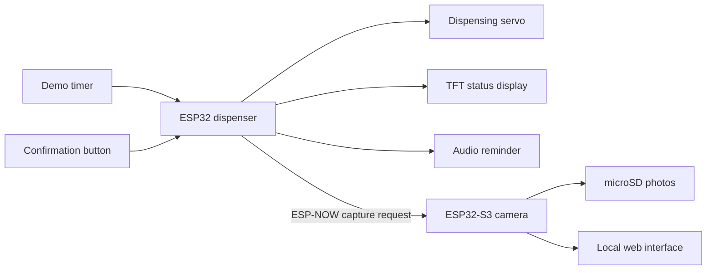

# ESP32 Smart Pill Dispenser

**A dual ESP32 prototype combining scheduled dispensing, audible reminders, a confirmation button, and camera capture.**

Built around an ESP32 dispenser and an ESP32-S3 camera node. Firmware is C++ using the Arduino framework and PlatformIO.

## How it works



The controller moves through idle, reminder, dispensing, waiting for confirmation, and confirmed states. Confirmation sends a capture request to the camera node, which stores a JPEG on microSD. A local web interface provides camera preview, photo access, and logs.

## Repository

| Path | Contents |
| --- | --- |
| `firmware/dispenser/` | Main ESP32 state machine and peripheral drivers |
| `firmware/camera/` | ESP32-S3 camera, storage, ESP-NOW receiver, and web server |

## Dispenser wiring

| Signal | ESP32 GPIO |
| --- | --- |
| TFT CS / SCL / SDA / reset | 5 / 18 / 23 / 17 |
| TFT backlight | Connected directly to 3.3 V |
| Servo | 13 |
| Confirmation button | 32, active LOW |
| Audio output | 25 |
| Hall sensor input | 34; currently disabled in the main loop |

Camera wiring is board-specific: inspect `firmware/camera/src/camera_pins.h` before connecting hardware. The camera configuration selects an ESP32-S3 with 16 MB flash and OPI PSRAM.

## Build and flash

Install PlatformIO Core. Copy `firmware/camera/src/secrets.example.h` to `firmware/camera/src/secrets.h` and set your own access-point password (at least 8 characters). The local `secrets.h` is excluded from Git. Then run from the repository root:

```powershell
pio run -d firmware/dispenser
pio run -d firmware/camera
pio run -d firmware/dispenser -t upload --upload-port COM4
pio run -d firmware/camera -t upload --upload-port COM7
pio device monitor -b 115200 -p COM4
```

Replace the COM ports with the ones assigned to your boards. The supplied configuration contains the original development ports.

## Configuration and prototype limits

- `firmware/dispenser/src/main.cpp` sets a **60-second demonstration interval** and a software clock starting at 12:00. It does not use a persistent real-time clock.
- Hall sensor support is present but disabled in the main application.
- `CameraClient` is a logging stub; the actual wireless capture request is sent through `EspNowClient`.
- The camera access-point password is supplied through the ignored local `secrets.h` file. Keep this file and captured photos private.
- This is an experimental assistive-device prototype, not a validated medication management device. A button press records confirmation; it does not verify ingestion.

## Validation

Documentation was checked against the supplied source. Compilation and physical operation have not been revalidated for this repository snapshot.
